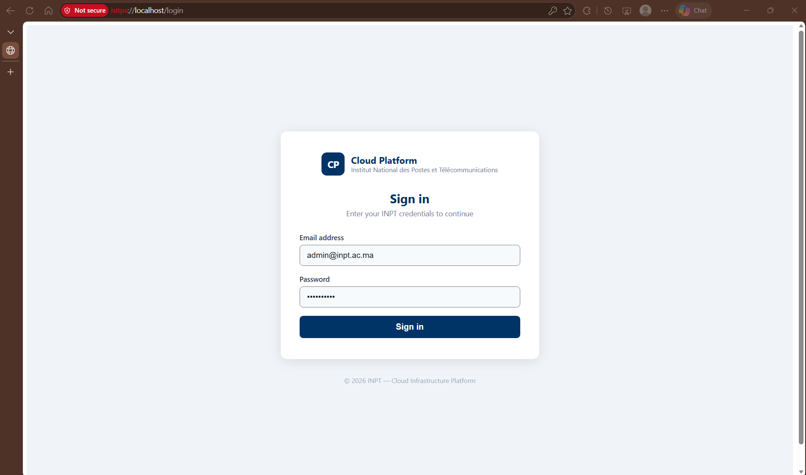
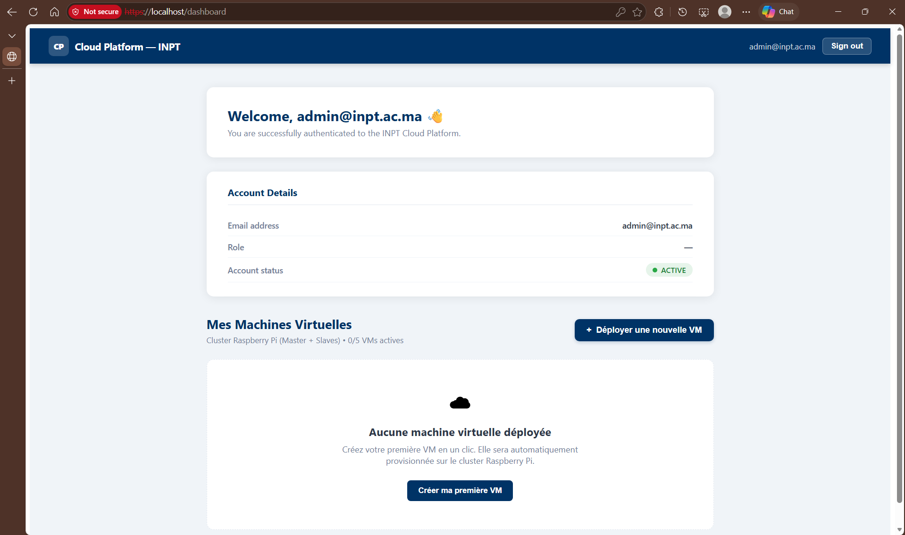
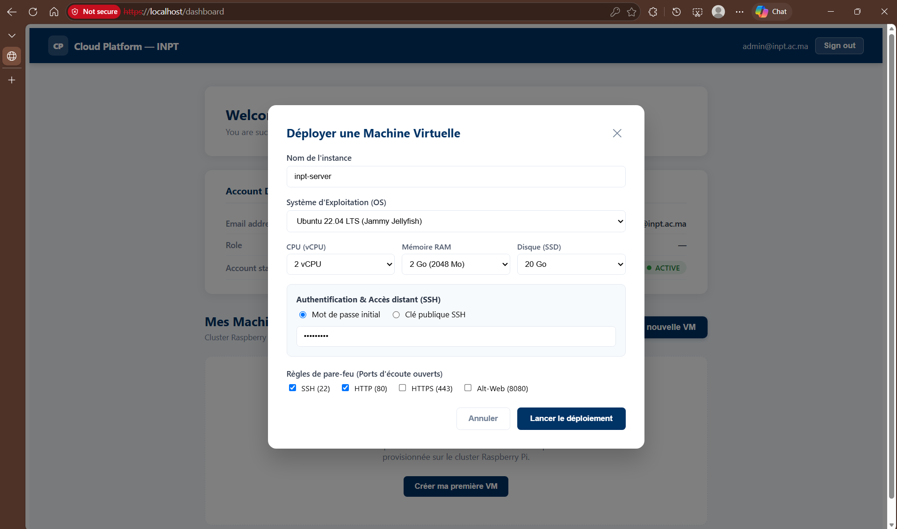
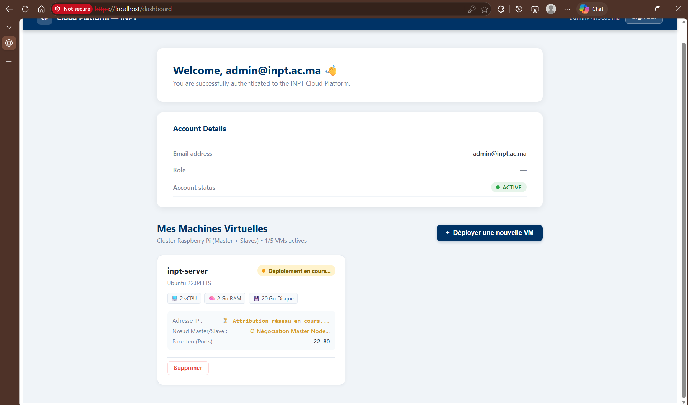
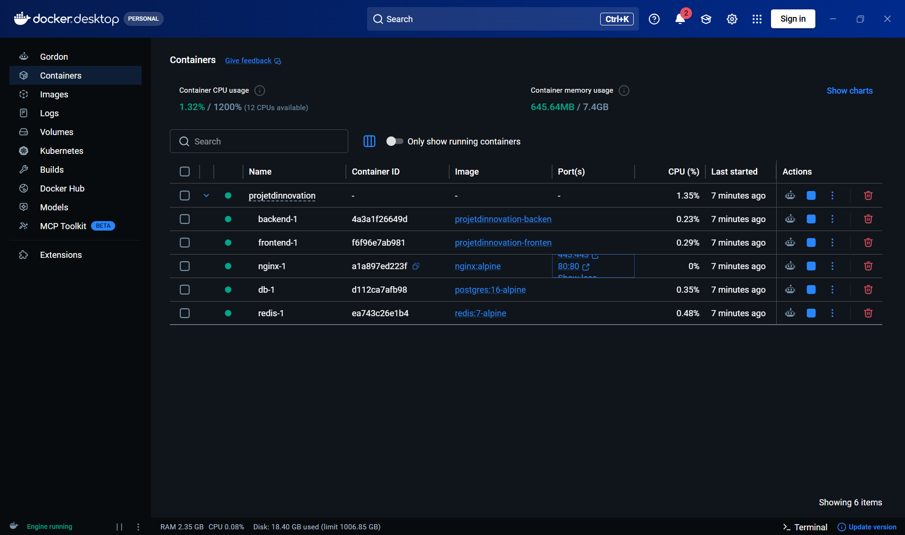
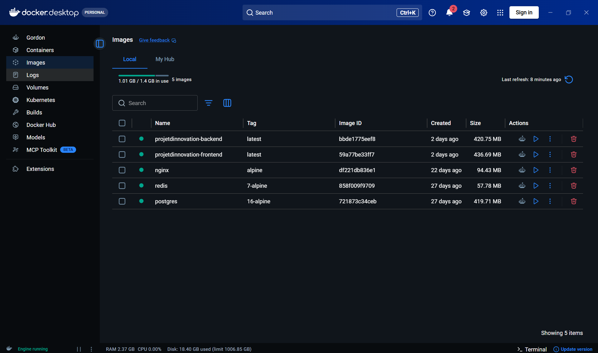

# INPT Cloud Platform — IaaS & Auth Service

> Plateforme Cloud d'Infrastructure (IaaS) avec système d'authentification sécurisé et module de provisionnement de Machines Virtuelles sur cluster Raspberry Pi (Master / Slaves).

---

## 📸 Aperçu & Captures d'écran

### 1. Authentification Sécurisée (US1)
Page de connexion conforme aux normes **NIST SP 800-63B** et **OWASP ASVS** (Argon2id, anti-énumération, limitation de débit).



---

### 2. Tableau de Bord & Suivi des VMs (US2)
Suivi en direct des instances déployées, adresses IP privées, nœuds Raspberry Pi assignés et commandes d'accès SSH.



---

### 3. Formulaire de Déploiement de Machine Virtuelle
Sélection de l'OS (Ubuntu, Debian, Alpine), allocation des ressources (vCPU, RAM, Disque), méthode d'accès (SSH / Mot de passe) et règles de pare-feu.



---

### 4. Provisionnement Asynchrone en Cours
Allocation asynchrone sur le cluster avec mécanisme automatique de rollback en cas d'erreur ou ressources insuffisantes.



---

### 5. Infrastructure Conteneurisée (Docker Desktop)
Les 5 services interconnectés et orchestrés via Docker Compose (Nginx, Backend, Frontend, PostgreSQL, Redis).

| Conteneurs en cours d'exécution | Images Docker construites |
| :---: | :---: |
|  |  |

---

## 🛠️ Stack Technique

* **Reverse Proxy & TLS :** Nginx Alpine (HTTPS forcé, HSTS, CSP durci)
* **Backend :** Spring Boot 3.3 (Java 21), Spring Security 6, Spring Data JPA
* **Frontend :** React 18, Vite, React Router, Axios
* **Base de données :** PostgreSQL 16 (Identifiants UUIDv7)
* **Gestion des sessions :** Redis 7 (Sessions distribuées, cookies `HttpOnly`, `Secure`, `SameSite=Lax`)
* **Hachage cryptographique :** Argon2id (`m=65536, t=3, p=1`)
* **Orchestration :** Docker Compose

---

## 🚀 Démarrage Rapide

### 1. Lancer l'infrastructure complète
```bash
docker compose up -d
```
Accéder à l'application : **`https://localhost`**

### 2. Identifiants de Démonstration (pré-remplis)

| Utilisateur | Email | Mot de passe | Statut |
| :--- | :--- | :--- | :--- |
| **Administrateur** | `admin@inpt.ac.ma` | `Admin1234!` | `ACTIVE` |
| **Étudiant (Demo)** | `demo@inpt.ma` | `Admin1234!` | `ACTIVE` |

*(Pour réinitialiser les comptes de test : `docker compose run --rm -e SPRING_PROFILES_ACTIVE=seed backend`)*

---

## 📡 Endpoints API Principaux

| Méthode | Route | Description | Accès |
| :--- | :--- | :--- | :--- |
| `POST` | `/api/auth/register` | Création d'un compte utilisateur | Public |
| `POST` | `/api/auth/login` | Authentification & création de session | Public |
| `POST` | `/api/auth/logout` | Révocation immédiate de la session | Session |
| `GET` | `/api/auth/me` | Informations du profil connecté | Session |
| `GET` | `/api/vms` | Liste des VMs de l'utilisateur | Session |
| `POST` | `/api/vms` | Déploiement d'une nouvelle VM | Session |
| `GET` | `/api/vms/{id}` | Détails d'une machine spécifique | Session |
| `POST` | `/api/vms/{id}/start` | Démarrage d'une VM arrêtée | Session |
| `POST` | `/api/vms/{id}/stop` | Arrêt d'une VM active | Session |
| `DELETE`| `/api/vms/{id}` | Destruction et nettoyage des ressources | Session |

---

## 🛡️ Sécurité & Résilience (OWASP & NIST)

* **Argon2id & Temps constant :** Protection contre les attaques temporelles et le cassage de mots de passe.
* **UUIDv7 :** Identifiants temporels non séquentiels empêchant le scraping d'URL.
* **Rate Limiting (Bucket4j) :** Protection contre les attaques par force brute (5 tentatives / min / IP).
* **Isolation Multi-tenant :** Chaque utilisateur ne peut accéder qu'aux VMs dont il est propriétaire.
* **Rollback automatique :** En cas d'erreur de provisionnement ou saturation mémoire, libération immédiate des ressources et marquage `FAILED`.
