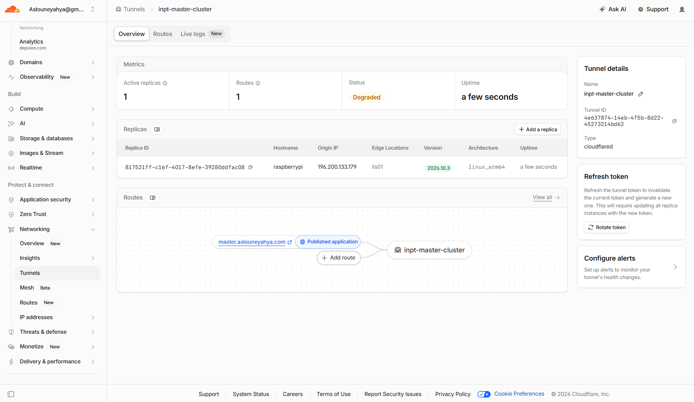
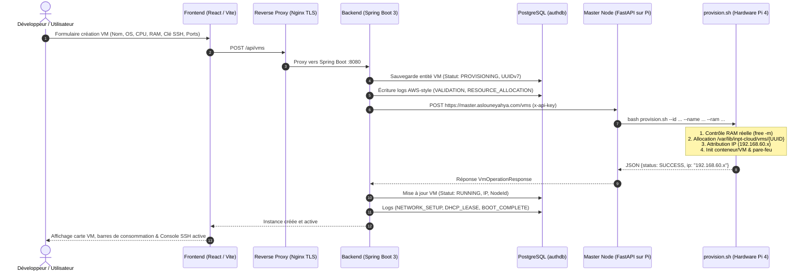

# INPT Cloud Platform — IaaS & Auth Service

> Plateforme Cloud d'Infrastructure (IaaS) avec système d'authentification sécurisé et module de provisionnement de Machines Virtuelles sur cluster Raspberry Pi (Master / Slaves).

---

## 📸 Aperçu & Captures d'écran

### 1. Authentification Sécurisée (US1)
Page de connexion conforme aux normes **NIST SP 800-63B** et **OWASP ASVS** (Argon2id, anti-énumération, limitation de débit).


---

### 2. Tableau de Bord & Suivi des VMs (US2)
Suivi en direct des instances déployées, adresses IP privées, nœuds Raspberry Pi assignés et commandes d'accès SSH.


---

### 3. Formulaire de Déploiement de Machine Virtuelle
Sélection de l'OS (Ubuntu, Debian, Alpine), allocation des ressources (vCPU, RAM, Disque), méthode d'accès (SSH / Mot de passe) et règles de pare-feu.


---

### 4. Provisionnement Asynchrone en Cours
Allocation asynchrone sur le cluster avec mécanisme automatique de rollback en cas d'erreur ou ressources insuffisantes.


---

### 5. Intégration du Nœud Maître Physique (Raspberry Pi) & Cloudflare Zero Trust (Sprint 2)
Interconnexion sécurisée entre le cluster Raspberry Pi local et le backend Cloud via **Cloudflare Tunnel** et **WARP** (contournement de l'isolation Wi-Fi et pare-feux).

| Tunnel Cloudflare & Réplique Active (ARM64) | Routage Public vers le Listener (`localhost:5000`) |
| :---: | :---: |
|  |  |

| Démon `cloudflared` & WARP Actifs sur Raspberry Pi | Mise à jour & Exécution des Scripts du Nœud Maître |
| :---: | :---: |
|  |  |

---

### 6. Contrôle Hardware Réel & Rollback Automatique (Anti-OOM)
Vérification des limites physiques de la Raspberry Pi (`free -m`) avant allocation : en cas de demande excessive (ex: 4 Go demandés alors que seulement 3.25 Go sont disponibles), le déploiement est rejeté avec un message d'erreur explicite et les ressources sont immédiatement libérées.


---

### 7. Infrastructure Conteneurisée (Docker Desktop)
Les 5 services interconnectés et orchestrés via Docker Compose (Nginx, Backend, Frontend, PostgreSQL, Redis).

| Conteneurs en cours d'exécution | Images Docker construites |
| :---: | :---: |
|  |  |

---

### 8. Dashboard Matériel Master Node & Télémétrie Physique (Sprint 3)
Supervision matérielle en temps réel accessible publiquement sur [`https://master.aslouneyahya.com/dashboard`](https://master.aslouneyahya.com/dashboard). Ce tableau de bord interroge directement les capteurs physiques du Raspberry Pi 4 (température SoC, charge système, mémoire vive, stockage NVMe/SD) et expose la consommation réelle calculée pour chaque machine virtuelle (CPU, RAM allouée vs utilisée, stockage).


---

### 9. Streaming des Journaux de Déploiement en Direct (AWS CloudWatch Style)
Console de streaming temps réel inspirée d'AWS CloudWatch. Chaque étape du cycle de vie (`VALIDATION`, `RESOURCE_ALLOCATION`, `STORAGE_INIT`, `CLOUD_INIT`, `NETWORK_SETUP`, `BOOT_COMPLETE`) est journalisée avec timestamp, niveau de sévérité (`INFO`, `WARN`, `ERROR`), filtrage dynamique, auto-scroll et option d'exportation au format `.log`.


---

### 10. Console Web SSH Interactive Intégrée
Terminal Web direct dans le navigateur émulant une véritable session SSH (`root@vm:~#`). Il permet aux utilisateurs et administrateurs d'exécuter des commandes système en direct, d'administrer leurs instances et d'interagir avec le système de fichiers sans nécessiter de client SSH tiers sur leur poste client.


---

### 11. Services Système & Connectivité Zero Trust sur Raspberry Pi (Sprint 3)
Maintien en conditions opérationnelles des services d'orchestration via les démons `systemd` (`inpt-master-node.service` et `cloudflared.service`), garantissant la haute disponibilité de l'API Edge et la connectivité Zero Trust avec Cloudflare sans ouverture de ports entrants.

| Démons Systemd Actifs sur Raspberry Pi | Statut Sain du Tunnel Cloudflare Zero Trust |
| :---: | :---: |
|  |  |

---

## 🛠️ Stack Technique & Justification des Choix

* **Reverse Proxy & TLS — Nginx (Alpine) :** Choisi pour son empreinte mémoire minime (<15 Mo), son débit élevé et sa fiabilité pour gérer la terminaison TLS 1.3, le forçage HTTPS, le HSTS et les en-têtes CSP stricts.
* **Backend — Spring Boot 3.3 (Java 21) & Spring Security 6 :** Retenu pour sa robustesse d'entreprise, sa gestion avancée du multithreading (Virtual Threads Java 21) et son écosystème mature garantissant une séparation stricte des couches (Controller, Service, Repository).
* **Nœud Maître (Edge) — Raspberry Pi 4 (ARM64) & FastAPI (Python 3) :** Le Raspberry Pi 4 offre une plateforme matérielle réelle basse consommation émulant un nœud bare-metal ; FastAPI a été sélectionné pour ses performances asynchrones natives et sa simplicité d'interaction directe avec les scripts système Bash Linux.
* **Connectivité Zero Trust — Cloudflare Tunnel (`cloudflared`) :** Élimine l'ouverture de ports entrants sur la box / pare-feu (aucun risque de scan de ports) et contourne l'isolation Wi-Fi universitaire grâce à un tunnel chiffré sortant sécurisé vers le domaine public.
* **Frontend — React 18 & Vite :** Vite procure un rechargement à chaud (HMR) instantané et des builds légers ; React 18 permet une interface réactive avec gestion fine des états en temps réel (streaming de logs, télémétrie matérielle, terminal Web SSH).
* **Base de Données — PostgreSQL 16 (Identifiants UUIDv7) :** SGBD relationnel garantissant la conformité ACID complète ; les UUIDv7 combinent un timestamp temporel et de l'aléa cryptographique, éliminant le risque d'énumération d'URL tout en préservant l'efficacité des index B-Tree.
* **Gestion des Sessions — Redis 7 :** Base clé-valeur in-memory ultra-rapide permettant des sessions distribuées découplées du cycle de vie du conteneur applicatif, avec révocation instantanée côté serveur (anti-rejeu).
* **Hachage Cryptographique — Argon2id :** Vainqueur officiel de la *Password Hashing Competition*, recommandé par l'ANSSI, le NIST et l'OWASP pour sa résistance maximale aux attaques par GPU, FPGA et canaux auxiliaires grâce à sa dureté mémoire et temporelle configurable.
* **Orchestration Locale — Docker Compose :** Standardise l'intégralité de la chaîne de services (Nginx, Backend, Frontend, Postgres, Redis) dans des conteneurs isolés et reproductibles sur n'importe quel environnement de développement.

---

## 🚀 Démarrage Rapide

### 1. Lancer l'infrastructure complète
```bash
docker compose up -d
```
Accéder à l'application : **`https://localhost`**

### 2. Identifiants de Démonstration (pré-remplis)

| Utilisateur | Email | Mot de passe | Statut |
| :--- | :--- | :--- | :--- |
| **Administrateur** | `admin@inpt.ma` | `Admin1234!` | `ACTIVE` |
| **Étudiant (Demo)** | `demo@inpt.ma` | `Admin1234!` | `ACTIVE` |

*(Pour réinitialiser les comptes de test : `docker compose run --rm -e SPRING_PROFILES_ACTIVE=seed backend`)*

---

## 📡 Endpoints API Principaux

| Méthode | Route | Description | Accès |
| :--- | :--- | :--- | :--- |
| `POST` | `/api/auth/register` | Création d'un compte utilisateur | Public |
| `POST` | `/api/auth/login` | Authentification & création de session | Public |
| `POST` | `/api/auth/logout` | Révocation immédiate de la session | Session |
| `GET` | `/api/auth/me` | Informations du profil connecté | Session |
| `GET` | `/api/vms` | Liste des VMs de l'utilisateur | Session |
| `POST` | `/api/vms` | Déploiement d'une nouvelle VM | Session |
| `GET` | `/api/vms/{id}` | Détails d'une machine spécifique | Session |
| `POST` | `/api/vms/{id}/start` | Démarrage d'une VM arrêtée | Session |
| `POST` | `/api/vms/{id}/stop` | Arrêt d'une VM active | Session |
| `DELETE`| `/api/vms/{id}` | Destruction et nettoyage des ressources | Session |

---

## 🛡️ Sécurité & Résilience (OWASP & NIST)

* **Argon2id & Temps constant :** Protection contre les attaques temporelles et le cassage de mots de passe.
* **UUIDv7 :** Identifiants temporels non séquentiels empêchant le scraping d'URL.
* **Rate Limiting (Bucket4j) :** Protection contre les attaques par force brute (5 tentatives / min / IP).
* **Isolation Multi-tenant :** Chaque utilisateur ne peut accéder qu'aux VMs dont il est propriétaire.
* **Rollback automatique :** En cas d'erreur de provisionnement ou saturation mémoire, libération immédiate des ressources et marquage `FAILED`.

---

## 🏗️ Cycle de Vie & Cartographie du Déploiement des VMs (Sprint 3)

### 1. Flux d'Exécution & Provisioning de Bout en Bout



---

### 2. Cartographie des Fichiers du Système de Déploiement

| Couche | Fichier Source | Rôle Système & Responsabilité |
| :--- | :--- | :--- |
| **1. UI Formulaire** | `frontend/src/components/VmManager.jsx` | Modal de création, validation côté client et affichage des jauges télémétriques temps réel. |
| **2. API Frontend** | `frontend/src/api/vms.js` | Requêtes Axios (`POST /api/vms`, `POST /exec`, `/logs`, `/start`, `/stop`). |
| **3. Proxy & Sécurité** | `nginx/nginx.conf` | Terminaison TLS 1.3, CSP, proxy vers backend et WebSocket upgrade. |
| **4. Contrôleur REST** | `backend/src/main/java/ma/inpt/cloud/vm/VmController.java` | Endpoints sécurisés, validation `@Valid`, gestion des quotas utilisateurs. |
| **5. Orchestrateur Métier** | `backend/src/main/java/ma/inpt/cloud/vm/service/VmService.java` | Génération UUID v7, journalisation AWS CloudWatch (`VmLog`), dispatching au cluster physique. |
| **6. Client Master Node** | `backend/src/main/java/ma/inpt/cloud/vm/client/MasterNodeClient.java` | Client HTTP Spring `RestClient` communiquant avec le Raspberry Pi via Cloudflare Tunnel. |
| **7. Listener API Edge** | `master-node/app/main.py` | API FastAPI sur le Pi recevant les ordres de provisioning, power et exécution Web SSH. |
| **8. Moteur Hardware** | `master-node/scripts/provision.sh` | **Moteur d'orchestration sur le Raspberry Pi** : contrôle des sondes mémoire réelles (`free -m`), création de `/var/lib/inpt-cloud/vms/<ID>/vm.conf`, isolation et pare-feu. |
| **9. Console Web SSH** | `master-node/scripts/exec.sh` | Moteur d'exécution bash directe pour les commandes Web SSH dans le conteneur/hôte. |
| **10. Dashboard Nœud** | `master-node/app/dashboard.py` | Générateur du Dashboard matériel Master Node (`https://master.aslouneyahya.com/dashboard`). |
| **11. Persistance DB** | `backend/src/main/java/ma/inpt/cloud/vm/VirtualMachine.java` | Entité JPA stockant l'état de l'instance, IP, ports, et association utilisateur. |

---

### 3. Emplacement Physique & Commandes d'Accès sur le Raspberry Pi

Sur le Raspberry Pi hôte, chaque instance virtuelle réside dans le système de fichiers local :

```text
/var/lib/inpt-cloud/vms/<VM_UUID>/
└── vm.conf    # Métadonnées : NAME, OS, CPU, RAM_MB, DISK_GB, IP, STATUS
```

#### Accès et administration directe en terminal sur le Pi :
```bash
# 1. Accès direct en SSH à une VM
ssh root@192.168.60.204

# 2. Exécuter une commande dans la VM via l'outil d'exécution local
cd ~/cloud-platform-inpt/master-node/scripts
./exec.sh --id <VM_UUID> --cmd "uname -a"

# 3. Inspecter la configuration de toutes les VMs déployées
cat /var/lib/inpt-cloud/vms/*/vm.conf

# 4. Démarrer ou éteindre une instance manuellement
./power.sh --id <VM_UUID> --action stop
./power.sh --id <VM_UUID> --action start
```

