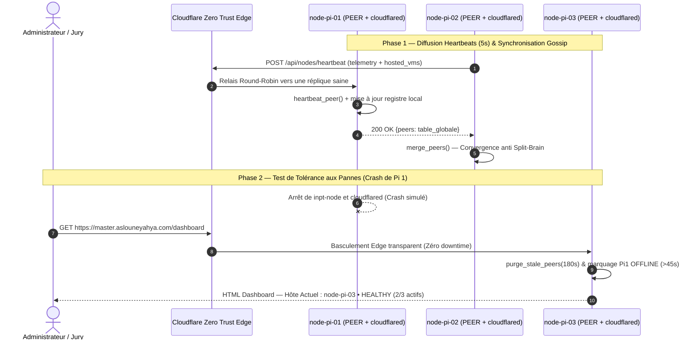

# INPT Cloud Platform — Sprint 5 : Cluster P2P Décentralisé, Haute Disponibilité & État d'Avancement

> **Projet d'Innovation — Institut National des Postes et Télécommunications (INPT, Rabat)**  
> **Étudiant :** Yahya ASLOUNE  
> **Encadrantes :** Pr. Safae DAHMANI & Pr. Kaouthar BOUSSELAM  
> **Branche de Référence :** `main` | **Dépôt :** [AslouneYahya/cloud-platform-inpt](https://github.com/AslouneYahya/cloud-platform-inpt)

---

## 🎯 Résumé Exécutif du Sprint 5

Le **Sprint 5** est **validé et clôturé** sur son volet infrastructure : le passage d'une topologie hiérarchique *Master / Workers* (introduisant un point de défaillance unique sur le nœud maître) à un **cluster 100% homogène et décentralisé Pair-à-Pair (Peer-to-Peer)** exécuté sur trois **Raspberry Pi 4 ARM64 physiques**, sans aucun SPOF (*Single Point of Failure*).

Bilan d'itération ([`BACKLOG.md`](BACKLOG.md)) :
* ✅ **Sprint 5 Terminé (`US5.1` à `US5.4`) :** Multi-workers, pool élastique décentralisé, unification P2P `cluster-node`, synchronisation Gossip, GC TTL 180s et bascule Cloudflare Tunnel zéro downtime validés sur matériel réel et par **19/19 tests unitaires**.
* 🚀 **Reporté / Planifié en Sprint 6 (`US6.1` à `US6.4`) :** Authentification fédérée OAuth2 / OIDC (**Google & GitHub Sign-In**), hybridation des sessions Redis 7 + Argon2id, et finalisation de l'outillage P2P/Control Plane (`POST /api/nodes/{node_id}/delete` et IP LAN réelle).

---

## 🏗️ Architecture Décentralisée P2P & Flux Gossip / Failover

Dans la nouvelle architecture unifiée ([`cluster-node/`](cluster-node/app/main.py)), les rôles `MASTER` et `WORKER` disparaissent au profit d'un démon identique **`PEER`** déployé sur chaque Raspberry Pi. Chaque nœud expose l'API et le Dashboard sur le port `5000`, gère localement KVM/QEMU, et maintient sa propre réplique sortante du tunnel **`cloudflared`** reliée au domaine public `https://master.aslouneyahya.com`.



---

## ✅ Ce qui a été fait dans le Sprint 5

### 1. US5.1 — Support Multi-Workers Simultanés (*Scale-Out Horizontal N > 1*)
* Enrôlement dynamique simultané de plusieurs nœuds (`d0ff3d1`), agrégation temps réel de la flotte de calcul : cœurs vCPU cumulés, pool RAM global, capacité disque et nombre de VMs KVM actives.
* Création du simulateur multi-nœuds [`worker-node/simulate_multi_workers.py`](worker-node/simulate_multi_workers.py) et de la suite de tests [`tests/test_us51_multi_worker_scaleout.py`](tests/test_us51_multi_worker_scaleout.py).

### 2. US5.2 — Pool Élastique Décentralisé, Watchdog & Haute Disponibilité Multi-Master
* Découplage des files de tâches dans [`master-node/app/nodes.py`](master-node/app/nodes.py) : introduction d'une file partagée (`shared_tasks`) où tout nœud sain ayant assez de RAM libre revendique les tâches, avec Watchdog de reprise après blocage (`> 18s`) ou perte de heartbeat (`> 25s`).
* Prototype d'élection de leader Multi-Master documenté dans [`docs/MULTI_MASTER_HA.md`](docs/MULTI_MASTER_HA.md) et implémenté dans [`master-node/app/ha.py`](master-node/app/ha.py) / [`worker-node/ha.py`](worker-node/ha.py) (priorité déterministe et *jitter backoff* anti split-brain).

### 3. US5.3 & US5.4 — Unification Pair-à-Pair (`cluster-node/`), Gossip & Observabilité Hôte Actif
Pour supprimer complètement la complexité et les risques d'élection *Master/Standby*, l'architecture a convergé vers un service unique identique sur chaque Raspberry Pi :
* **Démon unifié :** [`cluster-node/app/main.py`](cluster-node/app/main.py), [`cluster-node/app/mesh.py`](cluster-node/app/mesh.py), [`cluster-node/app/dashboard.py`](cluster-node/app/dashboard.py), [`cluster-node/app/image_manager.py`](cluster-node/app/image_manager.py), [`cluster-node/app/schemas.py`](cluster-node/app/schemas.py) et [`cluster-node/app/config.py`](cluster-node/app/config.py).
* **Installeur universel 1-clic :** [`cluster-node/install_node.sh`](cluster-node/install_node.sh) configure automatiquement QEMU/KVM, le stockage `/var/lib/inpt-cloud`, la réplique `cloudflared.service` et le démon `inpt-node.service` sur le port `5000`.
* **Scripts KVM bare-metal :** [`provision_kvm.sh`](cluster-node/scripts/provision_kvm.sh), [`power_kvm.sh`](cluster-node/scripts/power_kvm.sh), [`deprovision_kvm.sh`](cluster-node/scripts/deprovision_kvm.sh), [`exec.sh`](cluster-node/scripts/exec.sh) et [`check_health.sh`](cluster-node/scripts/check_health.sh).
* **Synchronisation Gossip anti Split-Brain (`8b73d60`) :** `call_cluster_domain()` récupère la table `peers` retournée par `/api/nodes/heartbeat` et fusionne les états via `peer_mesh.merge_peers()` afin que toutes les répliques Cloudflare convergent.
* **Garbage Collector distribué TTL 180s (`b32e9c1`) :** `purge_stale_peers(180.0)` évince définitivement tout nœud silencieux depuis plus de 3 minutes et empêche `merge_peers()` de ressusciter un nœud expiré.
* **Observabilité d'Hôte Actif (`60cf4c5`) :** Le dashboard P2P affiche en vert émeraude quel Raspberry Pi physique sert actuellement la requête publique (`📍 Hôte Actuel : node-pi-01` ou `node-pi-03` après bascule).

### 4. Suite de Tests Automatisés Validée (19 / 19)
Exécution via `python -m unittest discover -s tests -p "test_*.py" -v` :
* [`tests/test_us51_multi_worker_scaleout.py`](tests/test_us51_multi_worker_scaleout.py) : **3/3 OK**
* [`tests/test_us52_decentralized_pool.py`](tests/test_us52_decentralized_pool.py) : **5/5 OK**
* [`tests/test_ha_leader_election.py`](tests/test_ha_leader_election.py) : **5/5 OK**
* [`tests/test_unified_peer_node.py`](tests/test_unified_peer_node.py) : **6/6 OK** (incluant `test_gossip_merge_peers` et `test_reap_stale_dead_nodes`)

---

## 📸 Galerie de Preuves & Démonstration Visuelle (Sprint 5)

Les captures ci-dessous ont été réalisées en conditions réelles sur le domaine public **`https://master.aslouneyahya.com/dashboard`** connecté au cluster physique de **3 Raspberry Pi 4**.

---

### Capture 1 : Cluster P2P Opérationnel — 3 / 3 Nœuds Pairs en Ligne


* **Fichier :** [`screenshots/sprint5/dashboard will all nodes online.png`](<screenshots/sprint5/dashboard will all nodes online.png>)
* **Interface :** Dashboard P2P public sur `https://master.aslouneyahya.com/dashboard`.
* **Éléments Clés Vérifiés :**
  * **Hôte servant la requête :** `📍 Hôte Actuel : node-pi-01 • HEALTHY` (`Raspberry Pi 4 Model B Rev 1.5`, Uptime `up 4 hours, 10 minutes`).
  * **Pool de Calcul Consolidé (`CLUSTER DÉCENTRALISÉ P2P`) :**
    * **Cœurs vCPU Cumulés :** `12 Cœurs` (`ARM Cortex-A72`).
    * **RAM Pool :** `11382 Mo` au total (`3010 Mo consommés`, soit `26%`).
    * **Stockage Flotte :** `57.6 Go` (`23.1 Go libres`, soit `59%`).
    * **Flotte de Nœuds :** `3 / 3` (`3 Nœuds Pairs Actifs`).
  * **Topologie Multi-Nœuds :**
    * **`node-pi-01` (`PEER (HÔTE)` / `HÔTE ACTIF`) :** encadré lumineux émeraude, `ONLINE`, Temp `60.4°C`, RAM `30%` (`1155M`), `0` VM KVM.
    * **`node-pi-03` (`PEER`) :** `ONLINE`, Temp `56.0°C`, RAM `20%` (`792M`), `1` VM KVM.
    * **`node-pi-02` (`PEER`) :** `ONLINE`, Temp `56.5°C`, RAM `28%` (`1063M`), `1` VM KVM.

---

### Capture 2 : Preuve de Tolérance aux Pannes — Basculement Zéro Downtime après Arrêt de Node 1


* **Fichier :** [`screenshots/sprint5/dashboard after stopping node 1.png`](<screenshots/sprint5/dashboard after stopping node 1.png>)
* **Scénario Chaos Testing :** Arrêt volontaire du premier Raspberry Pi (**`node-pi-01`**) suivi d'un rafraîchissement direct du même lien public `https://master.aslouneyahya.com/dashboard`.
* **Preuves de Résilience Décentralisée :**
  * **Continuité de Service Totale :** Le lien public reste instantanément accessible sans modification DNS grâce à la réplique `cloudflared` active sur les autres nœuds.
  * **Bascule Automatique d'Hôte :** La barre d'état passe automatiquement sur **`📍 Hôte Actuel : node-pi-03 • HEALTHY`** (Uptime `up 4 hours, 43 minutes`) avec encadré vert émeraude sur la carte de **`node-pi-03` (`PEER (HÔTE)`)**.
  * **Détection de Panne Précise :** **`node-pi-01`** bascule en statut **`OFFLINE`** (pastille rouge, `RAM 0%`, bouton de retrait `🗑️`), tandis que le pool consolidé s'ajuste dynamiquement à **`2 / 3 Nœuds Pairs Actifs`** (`1849 Mo` consommés / `11382 Mo`, `16%`).
  * **Survie des Charges de Travail :** Les VMs KVM hébergées sur **`node-pi-03`** (1 VM, 57.0°C, 20% RAM) et **`node-pi-02`** (1 VM, 57.0°C, 27% RAM) restent opérationnelles sans aucune interruption.

---

## ⏳ Ce qui n'a pas encore été fait (Replanifié en Sprint 6)

En auditant l'état actuel du dépôt ([`BACKLOG.md`](BACKLOG.md), [`backend/pom.xml`](backend/pom.xml), [`SecurityConfig.java`](backend/src/main/java/ma/inpt/cloud/config/SecurityConfig.java) et [`LoginPage.jsx`](frontend/src/pages/LoginPage.jsx)), les éléments initialement envisagés pour l'authentification sociale et le durcissement Control Plane constituent désormais le **Sprint 6** :

1. **US6.1 — Authentification Sociale OAuth2 / OIDC avec Google Sign-In :**
   * La dépendance `spring-boot-starter-oauth2-client` n'est pas encore ajoutée dans `backend/pom.xml`.
   * La validation des tokens OIDC Google et le mapping automatique des comptes en base PostgreSQL ne sont pas encore implémentés.
2. **US6.2 — Authentification Sociale OAuth2 avec GitHub Sign-In :**
   * Configuration du client OAuth2 GitHub et récupération sécurisée des emails vérifiés non implémentées.
3. **US6.3 — Fédération d'Identité Unifiée & Hybridation de Session (Argon2id + OAuth2) :**
   * Le composant React `LoginPage.jsx` ne propose pas encore les boutons *« Continuer avec Google »* / *« Continuer avec GitHub »* unifiés avec les sessions Redis 7 existantes.
4. **US6.4 — Finalisation Outillage P2P & Couplage Control Plane :**
   * **Route de suppression manuelle manquante :** le bouton `🗑️` affiché dans `cluster-node/app/dashboard.py` sur les nœuds `OFFLINE` envoie `POST /api/nodes/{nodeId}/delete`, mais cette route (présente dans `master-node/app/main.py`) n'a pas encore été portée dans `cluster-node/app/main.py` (la suppression repose actuellement sur le GC automatique à 180s).
   * **Affichage IP `127.0.0.1` :** dans `cluster-node`, les nœuds s'auto-déclarent avec `lan_ip: "127.0.0.1"` car toute communication passe par le tunnel Cloudflare Zero Trust.
   * **Couplage Spring Boot `VmService` ↔ P2P :** validation de bout en bout du portail web avec le nouveau démon P2P.

---

## 🛠️ Problèmes Rencontrés & Résolutions Apportées

| Problème Rencontré | Cause Racine Identifiée | Solution Appliquée |
| :--- | :--- | :--- |
| **Erreurs 404 APT (`bullseye-security`) & blocages IPv6** lors de l'installation de QEMU/KVM sur Raspberry Pi | Anciens miroirs Debian Bullseye dépréciés et tentatives IPv6 défaillantes sur le réseau campus | Forçage IPv4 (`Acquire::ForceIPv4 "true"`), désactivation du dépôt `security.debian.org`, purge de `/var/lib/apt/lists/*` et `--no-install-recommends` (`7ea4a10`, `3bbd92c`, `1927439`). |
| **Nœuds invisibles entre eux** au démarrage initial de `cluster-node` | L'API savait *recevoir* `/api/nodes/heartbeat`, mais aucune boucle cliente ne diffusait l'état local | Ajout des tâches asynchrones `peer_heartbeat_broadcast_loop()` et `task_execution_loop()` dans `cluster-node/app/main.py` (`7ccf5de`). |
| **VMs des pairs non agrégées & 404 sur `/` Cloudflare** | `get_all_cluster_vms()` ne filtrait que `role == "WORKER"` et ignorait `"PEER"` ; route racine `/` manquante | Support de `("WORKER", "PEER")` dans `dashboard.py` (`95fea6d`) et exposition du dashboard sur `/`, `/dashboard` et `/dashboard/` (`93569a5`). |
| **Erreur HTTP 502 lors de l'arrêt partiel de `node-pi-01`** | Stopper uniquement `inpt-node` tout en laissant `cloudflared` actif sur le Pi 1 amenait Cloudflare à router vers un port `5000` fermé | Pour simuler un crash nœud réel, arrêt conjoint de `inpt-node` et `cloudflared` (ou coupure électrique) permettant à Cloudflare Edge de basculer immédiatement vers les répliques saines (Pi 2 / Pi 3). |
| **Split-Brain & nœuds affichés `OFFLINE` à tort** après redémarrage d'un nœud | Cloudflare répartit les requêtes en *Round-Robin* entre les répliques `cloudflared` : Pi 1 et Pi 3 recevaient des heartbeats différents sans les partager | Implémentation d'un **protocole Gossip** (`merge_peers` dans `mesh.py`) échangeant la table complète des pairs à chaque heartbeat et conservant l'horodatage le plus récent (`8b73d60`). |
| **Nœud fantôme / doublon `worker-pi-02` sur le tableau de bord** | Un ancien agent Worker Sprint 4 (`worker-pi-02`) continuait d'émettre depuis le **Pi 3** (ex-Worker 2 hébergeant `alpine-scaleout-w2`), masqué temporairement par `.replace("worker-", "node-")` dans l'UI | Suppression du masquage trompeur (`display_name = n_id`), arrêt du vieux démon sur Pi 3, et ajout du **Garbage Collector TTL 180s (`purge_stale_peers`)** empêchant le Gossip de ressusciter un nœud mort (`b32e9c1`). |

---

## 🧠 Explication des Choix d'Architecture & des Technologies

### 1. Choix d'Architecture

* **Pourquoi passer de *Master / Worker* (Sprint 4) à *Multi-Master HA* puis à *P2P Homogène (`cluster-node`)* (Sprint 5) ?**
  * Dans une topologie *Master / Worker*, le Master constitue un SPOF : s'il tombe, l'orchestration et le dashboard deviennent inaccessibles.
  * Une approche *Multi-Master avec élection* (`docs/MULTI_MASTER_HA.md`) réduit ce risque mais introduit deux bases de code distinctes (`master-node/` et `worker-node/`) et un risque de *split-brain* lors des transitions.
  * L'architecture **P2P homogène (`cluster-node/`)** résout les deux problèmes : **tous les Raspberry Pi exécutent exactement le même code et les mêmes droits (`PEER`)**. Il n'y a plus ni maître unique ni élection critique, la perte d'un nœud réduit simplement la capacité disponible sans aucune coupure de l'URL publique.

* **Pourquoi *Cloudflare Tunnel Replicas + Outbound Heartbeat/Gossip* au lieu d'IP locales statiques ou d'un VPN Mesh ?**
  * Le réseau Wi-Fi de l'INPT applique une **AP Client Isolation** qui bloque les communications directes IP-à-IP sur le LAN.
  * En combinant un connecteur `cloudflared` sortant sur chaque Raspberry Pi (pointant tous vers le même tunnel `master.aslouneyahya.com`) et des requêtes HTTPS sortantes (heartbeats + Gossip + task polling), le cluster contourne intégralement l'isolation Wi-Fi et les pare-feux NAT **sans jamais ouvrir aucun port entrant**.
  * Ce choix impose en contrepartie une convergence distribuée : d'où la mise en place de **Gossip (`merge_peers`)** + **Reaper TTL 180s (`purge_stale_peers`)** pour harmoniser l'état derrière le load-balancing Cloudflare.

* **Pourquoi séparer le *Control Plane Web* (Docker) du *Plan Edge / Hyperviseur* (`cluster-node`) ?**
  * **Control Plane (`docker-compose.yml`) :** porte la sécurité applicative, le multi-tenant, la persistance transactionnelle PostgreSQL, le cache de session Redis 7 et le portail utilisateur React.
  * **Plan Edge (`cluster-node/` sur Raspberry Pi 4 ARM64) :** s'exécute directement sur le système hôte Linux (*bare-metal*) afin d'accéder sans couche de contention supplémentaire à `/dev/kvm`, `qemu-system-aarch64`, `/sys/class/thermal`, `free -m` et `cloud-localds`.

### 2. Justification des Technologies Retenues

| Technologie | Rôle dans la Plateforme | Justification Technique |
| :--- | :--- | :--- |
| **QEMU / KVM ARM64 (`-enable-kvm -cpu host`)** | Hyperviseur matériel sur Raspberry Pi 4 | Exécute les VMs directement sur les cœurs ARM Cortex-A72 via `/dev/kvm` au lieu d'une émulation logicielle lente, offrant des performances quasi-natives avec une faible empreinte RAM. |
| **QCOW2 Copy-on-Write (`qemu-img`) + Cloud-Init** | Stockage différentiel & initialisation VMs | Permet de créer le disque d'une VM en `< 0.2s` en s'appuyant sur une image de base partagée en lecture seule (économie critique d'espace sur carte SD) et d'injecter clés SSH / mots de passe via ISO `cloud-localds`. |
| **Python 3 + FastAPI + Uvicorn + Pydantic** | Démon P2P léger (`cluster-node`) | Empreinte mémoire très réduite (~30 Mo mesurés par `systemd`), support asynchrone natif (`asyncio`) pour les boucles de heartbeat/polling parallèles, et validation stricte des schémas JSON. |
| **Bash + Systemd (`inpt-node`, `cloudflared`)** | Orchestration système & haute disponibilité | Interaction directe et fiable avec le noyau Linux (QEMU, sondes `/sys`, `free`, `df`), avec redémarrage automatique (`Restart=always`) à la mise sous tension des Raspberry Pi. |
| **Cloudflare Tunnel (`cloudflared` ARM64)** | Ingress Zero Trust & bascule HA multi-répliques | Fournit HTTPS/TLS automatique sur `master.aslouneyahya.com`, protège contre l'exposition d'IP publique et assure la bascule vers les nœuds survivants dès qu'un Pi tombe. |
| **Spring Boot 3.3.2 (Java 21) & Spring Security 6** | Backend Control Plane & sécurité API | Écosystème robuste d'entreprise pour l'isolation multi-tenant, le contrôle d'accès, les quotas utilisateurs et la préparation de l'intégration OAuth2/OIDC (planifiée en Sprint 6, US6.1–US6.3). |
| **Argon2id (`BouncyCastle`) & Bucket4j** | Hachage cryptographique & anti-brute-force | Argon2id (paramètres OWASP : `16B` sel, `32B` hash, `64 MiB` mémoire, `3` itérations) résiste aux attaques GPU/FPGA ; Bucket4j limite les tentatives de connexion par Token Bucket. |
| **PostgreSQL 16 (UUIDv7) & Redis 7** | Persistance ACID & gestion de sessions | PostgreSQL assure l'intégrité des VMs, journaux et utilisateurs avec UUIDv7 temporels non-énumérables ; Redis 7 stocke les sessions distribuées via `spring-session-data-redis` avec révocation immédiate. |
| **React 18, Vite & Nginx (Alpine)** | Frontend SPA & Reverse Proxy TLS | React 18 / Vite offrent une interface réactive (logs en direct, console Web SSH, graphiques) servie derrière Nginx Alpine (terminaison TLS, HSTS 2 ans, `X-Frame-Options: DENY`). |

---

## 🔬 Commandes de Vérification Rapide

```bash
# 1. Exécuter l'ensemble des 19 tests unitaires du cluster (Multi-worker, Pool P2P, HA, Gossip & GC)
python -m unittest discover -s tests -p "test_*.py" -v

# 2. Vérifier l'état du cluster P2P en direct via le domaine public Cloudflare
curl -s https://master.aslouneyahya.com/api/cluster/nodes | python3 -m json.tool

# 3. Vérifier quel Raspberry Pi physique sert actuellement la requête publique
curl -s https://master.aslouneyahya.com/health
```
