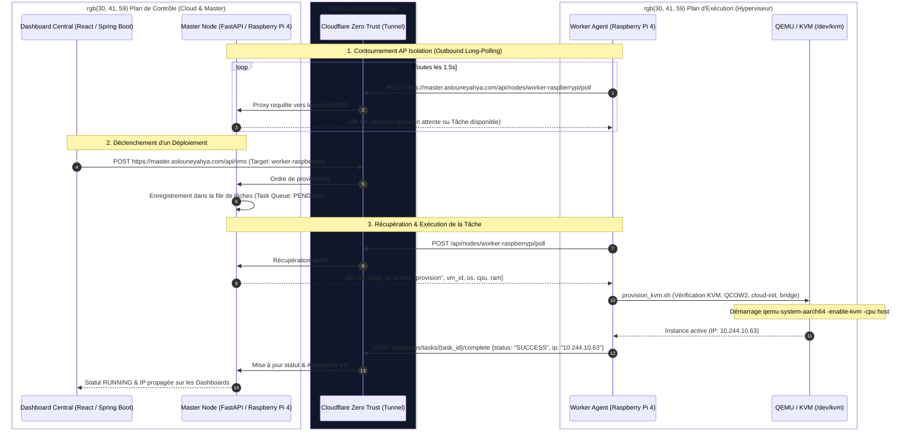
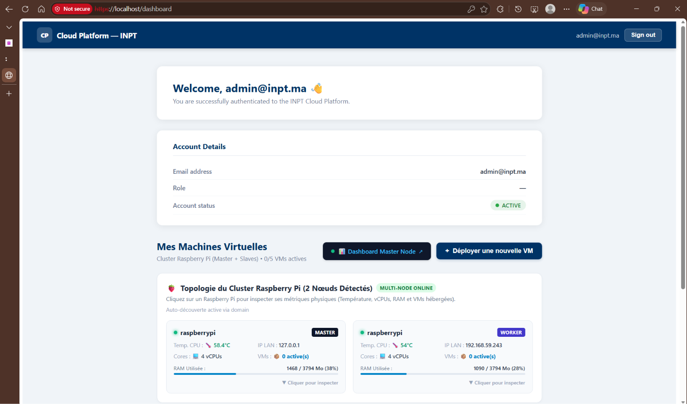

# INPT Cloud Platform — Sprint 4 : Cluster Multi-Nœuds & Virtualisation Matérielle KVM

> **Projet d'Innovation — Institut National des Postes et Télécommunications (INPT, Rabat)**  
> **Auteur :** Yahya ASLOUNE  
> **Encadré par :** Pr. Safae DAHMANI & Pr. Kaouthar BOUSSELAM  
> **Branche de Référence :** `main` | **Dépôt :** [AslouneYahya/cloud-platform-inpt](https://github.com/AslouneYahya/cloud-platform-inpt)

---

## 🎯 Résumé Exécutif du Sprint 4

Le **Sprint 4** marque une étape charnière dans le développement d'**INPT Cloud Platform** : la transition d'un nœud unique autonome vers une **architecture de cluster distribué multi-nœuds (Master / Workers)** avec **virtualisation matérielle KVM native sur architecture ARM64 (Raspberry Pi 4)**.

Ce sprint a permis de valider avec succès :
1. **L'orchestration distribuée multi-nœuds :** Séparation stricte entre le plan de contrôle (*Master Node* — coordination, API Edge, ordonnancement) et le plan d'exécution (*Worker Node* — hyperviseur KVM dédié).
2. **Le contournement de l'isolation Wi-Fi du campus (*AP Client Isolation*) :** Conception d'un patron architectural innovant d'**Outbound Tunnel Task Queue (Long-Polling via Cloudflare Tunnel Zero Trust)** éliminant le besoin de communication directe point-à-point LAN entre nœuds.
3. **Le placement intelligent (*Least-Loaded Scheduler*) :** Répartition dynamique et équilibrage des charges de travail en fonction de la télémétrie réelle (RAM libre, vCPU assignés, température).
4. **La virtualisation matérielle KVM réelle sur ARM64 :** Exécution de véritables machines virtuelles accélérées par le noyau Linux (`/dev/kvm`, `-enable-kvm -cpu host`) avec disques virtuels sparse Copy-on-Write (QCOW2).
5. **L'observabilité temps réel de bout en bout :** Streaming live des étapes de déploiement (AWS CloudWatch style), télémétrie matérielle des hôtes physiques et console Web SSH interactive.

---

## 🏗️ Architecture Technique & Innovations du Sprint 4

### 1. Le Défi de l'Isolation Wi-Fi Universitaire (AP Isolation) & La Solution "Outbound Tunnel Task Queue"

Sur le réseau Wi-Fi de l'INPT (`inpt.ac.ma`), les points d'accès activent la sécurité **Client Isolation (AP Isolation)** : les communications directes de pair-à-pair sur le sous-réseau local (`192.168.59.x -> 192.168.59.y`) sont systématiquement filtrées et rejetées par les routeurs du campus.



---

## 📸 Galerie de Preuves & Démonstration Visuelle (8 Captures)

Les 8 captures d'écran ci-dessous documentent l'intégralité du scénario de démonstration réel exécuté sur le matériel physique Raspberry Pi 4.

---

### Capture 1 : Découverte du Cluster & État Initial Multi-Nœuds



* **Fichier :** `cloudplatform.png`
* **Interface :** Tableau de bord local (`https://localhost/dashboard`) — Session `admin@inpt.ma`.
* **Éléments Clés :**
  * La barre supérieure de supervision du cluster affiche les deux nœuds physiques Raspberry Pi 4 détectés et synchronisés :
    * **`raspberrypi` [👑 MASTER] :** En ligne (`ONLINE`), 0/5 VMs actives, IP physique LAN, température 60.4°C, RAM 36%.
    * **`raspberrypi` [🍓 WORKER] :** En ligne (`ONLINE`), 0/5 VMs actives, IP LAN `192.168.59.243`, température 56.4°C, RAM 29%.
  * L'auto-découverte et les battements de cœur périodiques (*Heartbeats*) confirment la santé opérationnelle du cluster avant tout déploiement.

---

### Capture 2 : Modal de Déploiement d'une Machine Virtuelle KVM


* **Fichier :** `Capture d'écran 2026-11-18 231955.png`
* **Interface :** Formulaire de provisionnement guidé sur `https://localhost/dashboard`.
* **Paramètres Déployés :**
  * **Nom de l'instance :** `test-demo`
  * **Système d'exploitation :** `Alpine Linux 3.19` (Image minimale et ultra-rapide optimisée pour ARM64).
  * **Placement Cluster :** `🤖 Automatique — Least-Loaded Scheduler` (le scheduler analyse la charge respective des nœuds et oriente la charge vers le nœud le moins chargé).
  * **Ressources allouées :** 1 vCPU, 512 Mo de RAM, 2 Go de stockage SSD.
  * **Réseau & Sécurité :** Ports 22 (SSH) et 80 (HTTP) ouverts, authentification par mot de passe sécurisé.

---

### Capture 3 : Streaming des Logs en Direct (AWS CloudWatch Style)


* **Fichier :** `Capture d'écran 2026-11-18 232057.png`
* **Interface :** Console de streaming des logs en temps réel pour l'instance `test-demo` (UUID : `01a1f0f6-63b6-7918-84cf-e7bdcd41c0c4`).
* **Jalons d'Orchestration Capturés :**
  * `[23:20:47] [INFO] [VALIDATION]` : Contrôle de conformité des quotas et de la validité de l'utilisateur.
  * `[23:20:47] [INFO] [RESOURCE_ALLOCATION]` : Réservation de 1 vCPU, 512 Mo RAM, 2 Go SSD.
  * `[23:20:48] [INFO] [STORAGE_INIT]` : Initialisation de l'image disque différentielle QCOW2 sparse.
  * `[23:20:48] [INFO] [CLOUD_INIT]` : Injection de la configuration système (hostname, utilisateur, clés).
  * `[23:20:49] [INFO] [NETWORK_SETUP]` : Configuration du bridge virtuel et des règles de pare-feu.
  * `[23:20:49] [INFO] [DISPATCH_EDGE]` : Transmission de l'ordre au Nœud Maître via `https://master.aslouneyahya.com`.
  * `[23:20:53] [INFO] [DHCP_LEASE]` : Attribution du bail IP privé `10.244.10.63`.
  * `[23:20:53] [INFO] [BOOT_COMPLETE]` : Confirmation du démarrage effectif de la machine virtuelle sur le nœud `worker-raspberrypi`.

---

### Capture 4 : Instance Active & Télémétrie en Temps Réel sur le Worker


* **Fichier :** `Capture d'écran 2026-11-18 232131.png`
* **Interface :** Dashboard local après provisionnement réussi.
* **Éléments Remarquables :**
  * La barre de cluster met à jour l'état : **Master (0 active)** et **Worker (1 active, 29% RAM, 55.5°C)**.
  * La carte de l'instance `test-demo` affiche :
    * Badge de statut : `Actif (Running)`.
    * Badge de placement physique : `📍 worker-raspberrypi`.
    * Adresse IP privée interne : `10.244.10.63`.
    * Télémétrie de consommation en direct : **CPU 0.6%**, **RAM 64 Mo / 512 Mo (12.5%)**, **Disque 0.9 Go**.
    * Bouton d'accès immédiat à la **Console Web SSH interactive**.

---

### Capture 5 : Tableau de Bord Public du Master Node (`master.aslouneyahya.com`)


* **Fichier :** `Capture d'écran 2026-11-18 232218.png`
* **Interface :** Console d'administration Master Node accessible publiquement via Cloudflare Zero Trust.
* **Preuves d'Agrégation Multi-Nœuds :**
  * Télémétrie matérielle de l'hôte Master Raspberry Pi 4 : 4 Coeurs ARM Cortex-A72, 1468 Mo RAM, 5.8 Go stockage SD, température 59.9°C.
  * Topologie du Cluster :
    * `master-rpi-01` (👑 MASTER) : 59.9°C | 38% RAM | 0 VMs hébergées.
    * `worker-raspberrypi` (🍓 WORKER) : 57.9°C | 29% RAM | 2 VMs hébergées.
  * Tableau global des instances du cluster : agrégation dynamique des VMs hébergées sur le worker (`test-demo` - `10.244.10.63` et `alpine-worker-demo` - `10.244.10.136`).

---

### Capture 6 : Console Matérielle HDMI — Nœud Maître Physique (Raspberry Pi 4)


* **Fichier :** `WhatsApp Image 2026-11-18 at 23.23.46.jpeg`
* **Dispositif Physique :** Écran HDMI branché directement sur le Raspberry Pi 4 physique faisant office de **Master Node** (`pi-master@raspberrypi`).
* **Vérification :**
  * Le navigateur Chromium local tourne sur `http://localhost:5000/dashboard`.
  * L'affichage coïncide rigoureusement avec la console publique Cloudflare, attestant de l'exécution matérielle bare-metal.

---

### Capture 7 : Démon Système & Flux HTTP du Long-Polling (Nœud Maître)


* **Fichier :** `WhatsApp Image 2026-11-18 at 23.24.10.jpeg`
* **Terminal Physique :** Session shell sur le Master Pi montrant l'état du démon système :
  * Commande : `sudo systemctl status inpt-master-node.service`
  * Statut : `Active: active (running)` (PID 45943, mémoire 29.8 Mo).
  * Logs d'accès Uvicorn / FastAPI :
    * Requêtes continues `POST /api/nodes/heartbeat` (Worker -> Master, HTTP 200 OK).
    * Requêtes de scrutation `POST /api/nodes/worker-raspberrypi/poll` (Task Queue, HTTP 200 OK).
    * Requêtes de consultation `GET /dashboard` (HTTP 200 OK).

---

### Capture 8 : Preuve d'Exécution Matérielle KVM sur le Nœud Worker


* **Fichier :** `WhatsApp Image 2026-11-18 at 23.28.48.jpeg`
* **Terminal Physique :** Écran HDMI branché sur le second Raspberry Pi 4 physique faisant office de **Worker Hyperviseur** (`pi-worker-1@raspberrypi`).
* **Vérification Médico-Légale (Forensics) :**
  * Commande `ps aux | grep qemu-system` :
    ```bash
    qemu-system-aarch64 -M virt -enable-kvm -cpu host -m 512M -smp 1 \
      -drive file=/var/lib/inpt-cloud/vms/01a1f0f6-63b6-7918-84cf-e7bdcd41c0c4/disk.qcow2,if=virtio,format=qcow2 \
      -netdev user,id=net0 -device virtio-net-pci,netdev=net0 -display none -daemonize
    ```
  * Présence flagrante du flag **`-enable-kvm -cpu host`** confirmant que le code de la VM s'exécute directement sur les registres matériels du processeur ARM Cortex-A72 du Raspberry Pi (accélération matérielle native).
  * Fichier de configuration `/var/lib/inpt-cloud/vms/01a1f0f6-63b6-7918-84cf-e7bdcd41c0c4/vm.conf` :
    ```ini
    ID=01a1f0f6-63b6-7918-84cf-e7bdcd41c0c4
    NAME=test-demo
    OS=Alpine Linux 3.19
    CPU=1
    RAM_MB=512
    DISK_GB=2
    IP=10.244.10.63
    STATUS=RUNNING
    ```

---

## 🔬 Matrice de Validation & Commandes de Vérification

Pour vérifier l'état du cluster et des machines virtuelles KVM de manière autonome :

| Composant | Commande de Vérification | Résultat Attendu |
| :--- | :--- | :--- |
| **Accélération KVM** | `ls -l /dev/kvm` | `crw-rw---- 1 root kvm 10, 232` présent sur le Worker |
| **Processus Hyperviseur** | `ps aux \| grep qemu-system-aarch64` | Processus actif avec `-enable-kvm -cpu host` |
| **Disque Virtuel QCOW2** | `qemu-img info /var/lib/inpt-cloud/vms/<ID>/disk.qcow2` | Format QCOW2, taille virtuelle 2GB, sparse réel <100MB |
| **Configuration VM** | `cat /var/lib/inpt-cloud/vms/<ID>/vm.conf` | `STATUS=RUNNING`, IP assignée, CPU=1, RAM=512 |
| **Connectivité Master** | `curl -s https://master.aslouneyahya.com/api/nodes` | JSON listant `master-rpi-01` et `worker-raspberrypi` |
| **Démon Master** | `sudo systemctl status inpt-master-node.service` | `active (running)` sans interruption |
| **Démon Worker** | `sudo systemctl status inpt-worker-node.service` | `active (running)` exécutant le long-polling |

---

## 🎓 Remerciements & Encadrement

Ce travail a été réalisé sous l'encadrement académique et scientifique bienveillant de :
* **Pr. Safae DAHMANI** (Professeure à l'INPT Rabat)
* **Pr. Kaouthar BOUSSELAM** (Professeure à l'INPT Rabat)

*INPT Cloud Platform — Projet d'Innovation 2026.*
